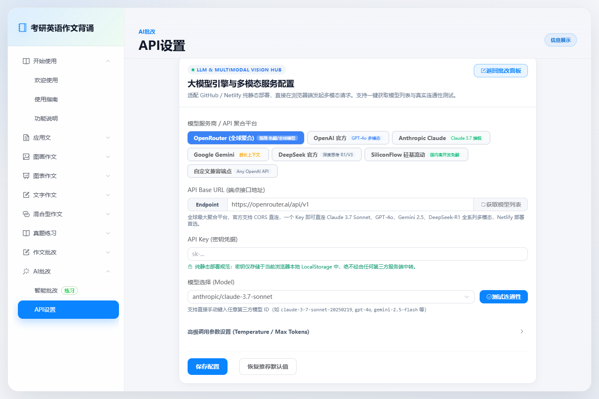
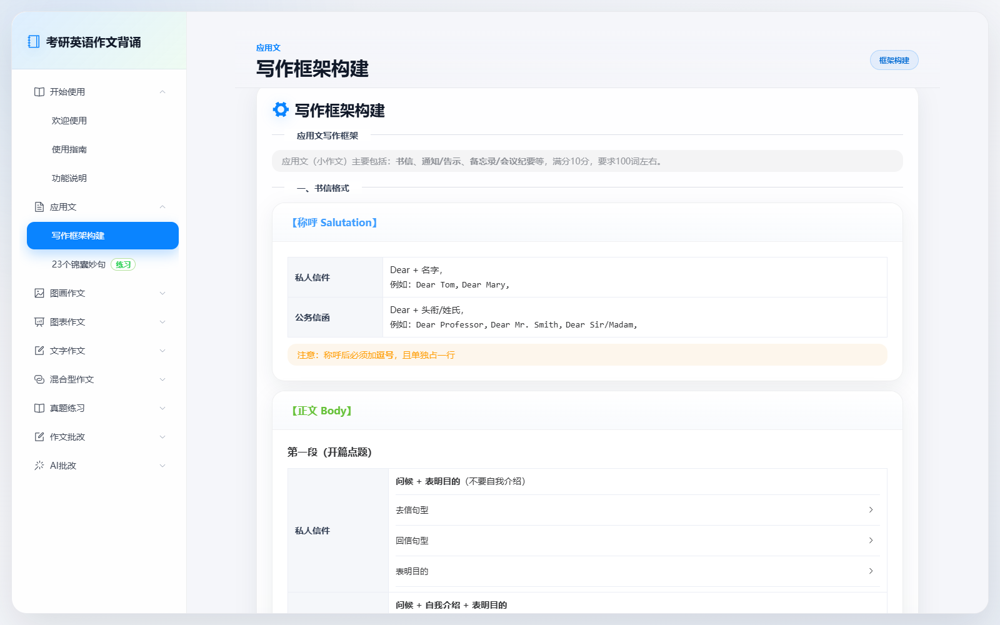
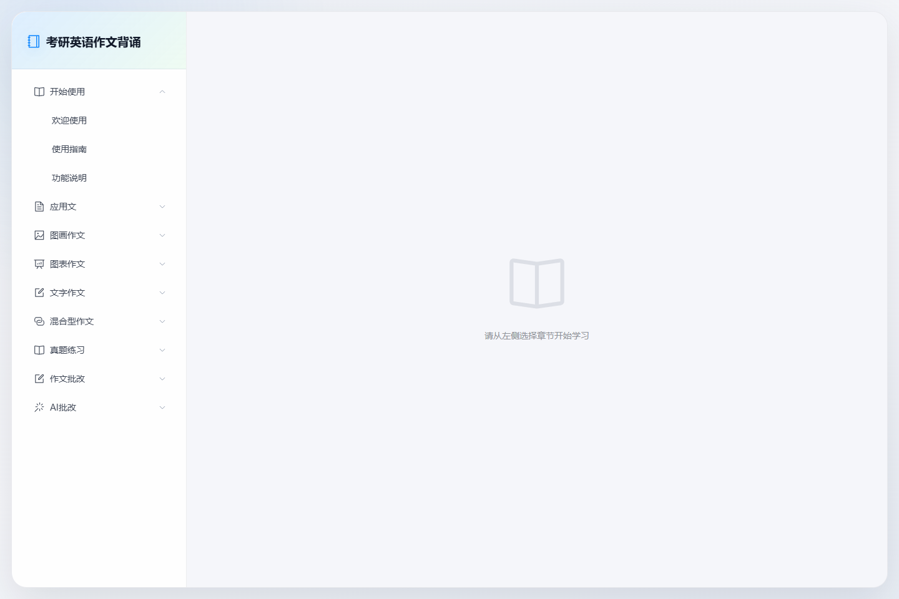
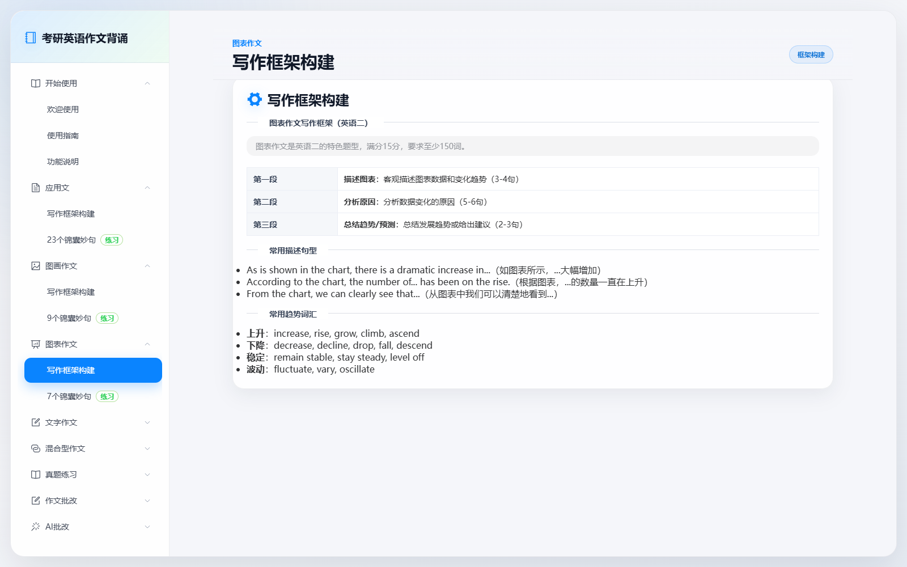
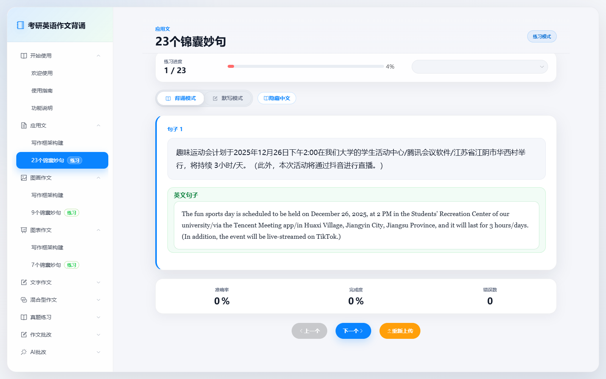

# 考研英语作文备考与智能诊断系统 (StudyPath English Writing)

[](https://vuejs.org/)
[](https://vitejs.dev/)
[](https://element-plus.org/)
[](https://opensource.org/licenses/MIT)

专为**全国硕士研究生招生考试（英语一 / 英语二）**打造的全流程作文复习与智能批改辅助系统。整合「中英文分句强化背诵」、「真迹级五大写作框架思维导图」、「历年真题分类研习」、「现代主流多模态 AI 考研答题卡拍照批改」及「答题纸高保真直接导出」全链路闭环，助力考生高效突破英语一大作文 20+/30、小作文 8+/10；英语二大作文 12+/15、小作文 8+/10。

---

## 🌟 核心特性与界面展示

### 1. 🤖 考研官方维度 AI 智能批改（支持多模态与标准答题卡范文）
- **多模态答题卡拍照识别**：支持考生上传手机拍摄的手写答题卡试卷或作图，智能前端压缩后直接输送给视觉大模型（Vision LLM）解析手写卷面。
- **考研官方判卷规范**：深度重构 Prompt 诊断逻辑，严格对照大纲四个维度（内容完整度、篇章连贯性、语言地道度、卷面格式）逐句深度精批。
- **高保真考研答题卡范文排版**：针对考研官方评分对**首行缩进（严格 4 个半角字符空格）、书信称呼顶格逗号、通知公告居中大写、署名 Li Ming** 等刚性要求，提供衬线体 Times New Roman 与防真考场横线格排版示范。
- **卷面格式自检清单**：自动输出段落分布词数分析与卷面格式合规核查。


---

### 2. 📥 诊断结果一键多格式导出
支持将评卷报告与答题纸范文快速保存并分享，提供三种导出模式：
- **📄 导出 Markdown 报告 (`.md`)**：完整保留考生题目要求、考生作文正文、各项评分细则与 Markdown 排版，方便导入 Obsidian、Notion 等知识库。
- **🌐 导出独立高清 HTML 报告 (`.html`)**：离线单文件封装，内嵌考研答题纸水印与横线 CSS，无需联网即可用任何浏览器双击查阅。
- **🖨️ 打印 / 另存为 PDF**：一键调用系统原生打印，预置无页眉页脚干净打印媒体样式，方便考前纸质装订背诵。


---

### 3. ⚙️ 前沿多模态大模型配置与动态连通测试
- **主流前沿模型生态直连**：内置 Gemini (2.5/2.0 Flash)、Claude 3.7/3.5、OpenAI (GPT-4o/o3-mini)、DeepSeek (V3/R1)、Kimi 等一键预设，亦支持兼容 OpenAI 协议的自定义 API 中转端点。
- **动态模型列表拉取**：填写 Key 后即可点击「动态获取模型列表」，直接从服务商后端拉取真实可用模型，告别手填盲猜。
- **实时端点 Ping 测速**：一键发起健康检查与握手延迟测试，状态直观可视。
- **纯前端隐私沙盒**：所有 Key 与自定义配置均保存在浏览器本地 `localStorage`，零服务端中转，安全防泄露，完全适配部署至 GitHub Pages、Netlify 等纯静态环境。



---

### 4. 📐 全景写作框架与真题精解体系
- **覆盖全大纲题型**：应用文（书信/通知/备忘录）、图画作文（九句三段论）、图表作文（七句柱饼线表）、文字大纲作文、混合型作文。
- **结构化思维导图与锦囊妙句**：将各段核心功能句、过渡衔接词、高级替换搭配拆解为清晰的交互式卡片。
- **大纲样题与真题套用印证**：历年真题分类展示，支持一键折叠与重点高亮。

| 应用文全套框架 | 图画作文写作框架 | 图表作文写作框架 |
| :---: | :---: | :---: |
|  |  |  |

---

### 5. ✍️ 分句对照背诵与实时智能默写
- **双模态沉浸练习**：可在「背诵模式（中英对照）」与「默写模式（中文提示+全英键入）」间自由切换。
- **字词级容错与高亮比对**：实时对比标出正确（绿色）、拼写错误（红色）与遗漏成分（黄色），强化考场肌肉记忆。
- **学习进度追踪**：准确率、完成度与错题统计即时反馈。



---

## 🛠️ 技术栈

| 层次 / 工具 | 选用方案 | 核心价值 |
| :--- | :--- | :--- |
| **核心前端框架** | Vue 3 (Composition API / `<script setup>`) | 响应式状态管理与组件化开发 |
| **构建工具** | Vite 5.x | 秒级冷启动、高效热重载与现代化单页打包 |
| **组件库** | Element Plus 2.x | 企业级开箱即用 UI、深色适配与灵活交互 |
| **图标库** | `@element-plus/icons-vue` | 考研功能图标语义化表达 |
| **Markdown 引擎** | `marked` | 高性能流式 Markdown 转 HTML 解析 |
| **多模态协议** | OpenAI Chat Completions / Vision API | 标准化 Base64 / URL 多模态图片与文本评测传输 |

---

## 📁 目录结构

```text
StudyPath English Writing/
├── docs/
│   └── assets/                  # 高清真实界面展示图库
├── public/
│   ├── template.txt             # 考研经典背诵句库
│   └── templates/               # 真题及范文分类数据
├── src/
│   ├── components/
│   │   ├── AiConfig.vue         # 现代 API 配置卡片（动态获取模型 / Ping测速）
│   │   ├── AiCorrection.vue     # 智能批改面板（多模态/答题卡范文/多格式导出）
│   │   └── Sidebar.vue          # 章节与功能导航侧边栏
│   ├── App.vue                  # 核心单页框架与章节路由器
│   ├── chapters.js              # 考研五大题型与批改系统章节清单
│   └── main.js                  # 入口与样式挂载
├── package.json
└── vite.config.js
```

---

## 🚀 快速启动与部署

### 1. 本地运行

```bash
# 1. 克隆仓库并进入项目根目录
git clone https://github.com/your-username/StudyPath-English-Writing.git
cd "StudyPath-English Writing"

# 2. 安装项目依赖
npm install

# 3. 启动开发服务器
npm run dev
```

浏览器打开 `http://localhost:5173` 即可开始使用。

### 2. 生产构建

```bash
npm run build
```

构建生成的静态资产位于 `dist/` 目录下，可直接部署至任何静态托管平台（GitHub Pages, Netlify, Vercel, Cloudflare Pages 等）。

---

## 📝 许可证

本项目基于 [MIT License](LICENSE) 开源。欢迎考研学子、英语学习者提出 Issue 与 PR 共同完善！
